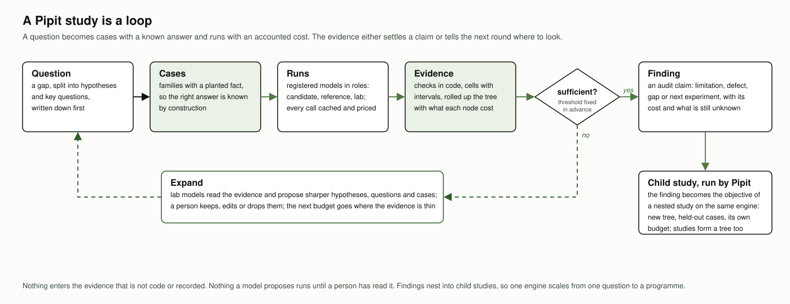

# Pipit

A data-first workbench for measuring and improving AI systems.

Pipit treats data as an experimental instrument. It turns a question about a model into a small, efficient experiment: a constructed set of cases, a budgeted sample, and a claim whose evidence is accounted for, including where the evidence is not enough.

**Status:** `v0.0.2` (2026-10-31): the core and the first real study, P1, are on `main` under M3; M1 and M2 remain open. See `docs/design.md`.

## The discipline

- **The unit of work is an evidence claim, not a run.** Every claim carries its budget, its sample, its uncertainty and one of four verdicts: model limitation, defective case or judge, coverage gap, or needs another experiment.
- **The instrument is proven before any real model.** A synthetic subject with planted limitations, planted defective cases and planted coverage holes must get the right verdicts first.
- **Methods are candidates too.** A sampler or an inference method stays only if it beats uniform sampling at equal budget, inside Pipit.
- **A finding says four things.** What was tested, what happened, why it matters, and what is still unknown.

## Two kinds of model

| Role | What it is | Rule |
| --- | --- | --- |
| **Candidate** | the model under test | only queried; its outputs never shape gold, cases or judgments |
| **Lab model** | a model Pipit uses as a tool, small or large: generating or paraphrasing cases, judging where no executable check exists, embedding for coverage | declared in the manifest with its version and settings; used only where an executable check cannot do the job; its judgments are calibrated against executable checks or adjudicated cases before they count; never the candidate it judges |

Lab models are reached through hosted APIs: TypeSafe for decision models and OpenRouter for small, medium and large LLMs. That keeps references and use cases across sizes without Pipit hosting inference. Keys live in the environment, never in the repository.

Both are reached through the same contract: a subject is a callable from a case to an answer, plus a manifest (identifier, revision, settings). Pipit's core imports no model library. Adapters are small, live at the edge, and are the only place a model's SDK appears. That is what makes Pipit reusable for any model, local or hosted.

## Milestones

One question each. A milestone closes with a tagged release and a note on what changed in understanding.

| | Question | Done when |
| --- | --- | --- |
| M0 | Can a change reach `main` only through an issue, a pull request, CI and review? | the first pull request merged green; tag `v0.0.1` |
| M1 | Does the evidence ledger give the right verdict on a synthetic subject with planted limitations, defects and coverage holes? | verdict accuracy and false-claim rate reported |
| M2 | Does any adaptive sampler beat uniform sampling at equal budget on that subject? | keep or kill, with the budget curve |
| M3 | On one 4B candidate with dense prior evidence, does Pipit find a critical limitation with a fraction of the cases a full grid needs, confirmed on a protected split of case families? | one finding, or one documented insufficiency |

First candidates: typed decision models around 4B parameters.

## Studies

A study is a folder under `studies/` with a pre-registration, a hypothesis tree, model manifests, an immutable case
set, the runs and the report. The first is `studies/p1_clinical/`: ten case families, 120 cases, the Perplexity
4B decider as candidate, Jev as reference, two lab models for construction.

    uv sync --extra local --extra typesafe            # adapters' libraries; the core needs none of them
    uv run python studies/p1_clinical/build_cases.py  # reproduces the case set from the cache at no cost
    uv run python studies/p1_clinical/run.py models/pplx_flash.yaml --role candidate
    uv run python studies/p1_clinical/run.py models/jev.yaml --role reference
    uv run python studies/p1_clinical/analyse.py      # report.md
    uv run python studies/p1_clinical/propose.py      # proposals.md, for human review

Models are registered by YAML manifest (identifier, revision, adapter, placement, device, dtype, the name of the
environment variable that holds the key) and resolved through an adapter at the edge; see `docs/design.md`.

## How work moves

issue → branch → pull request → CI → review → merge → release

- Every change starts as an issue under a milestone and ends as one small pull request that references it. Nothing is pushed to `main`.
- A change to behaviour ships with a test. CI runs lint and tests on every pull request. Nothing merges red.
- Docs change in the same pull request as the code they describe. Branch names: `m<N>/<topic>`.

## Versioning

Three things carry versions, separately.

| Thing | Scheme | Now |
| --- | --- | --- |
| Code | SemVer. `0.0.z` while the instrument is unproven on a real model (M0 to M2); `0.1.0` at M3; `1.0.0` when the claim schema is stable | `0.0.2` |
| Schemas (case, claim, manifest) | an integer `schema_version` inside every artifact, bumped on any breaking change | not yet defined |
| Case sets and runs | content hash plus generator seed; immutable once a claim references them | not yet defined |

`CHANGELOG.md` follows Keep a Changelog.

## Run

    uv sync
    uv run ruff check . && uv run ruff format --check .
    uv run pytest
