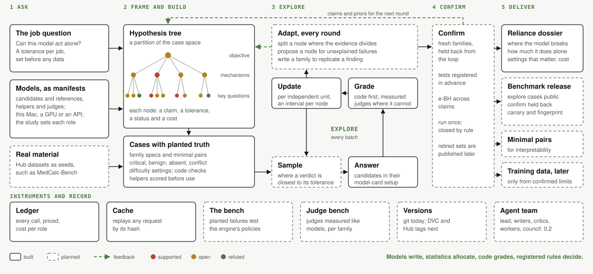

# Pipit

A data-first workbench for measuring and improving AI systems.

Pipit treats data as an experimental instrument. It turns a question about a model into a small, efficient experiment: a constructed set of cases, a budgeted sample, and a claim whose evidence is accounted for, including where the evidence is not enough.

**Status:** `v0.0.4` (2026-11-01). Working toward 0.1.0, the first version others can use, through small releases
that each answer one question: see `docs/plan.md`.

**Read in this order:** `docs/plan.md` (what Pipit is for, whom it helps, the path to 0.1), `docs/methodology.md`
(the playbook every study and agent follows), `docs/architecture.md` (the components, loops, configuration and memory),
`docs/design.md` (the loop and the instrument), `docs/landscape.md` (Pipit against the field: what it gets wrong, what
it adds, the literature), `docs/programme.md` (the studies), `docs/agentic.md` (the study team, for 0.2).

**How the engine reasons and what it has found:** `docs/engine.md`. **The plan by module, with who does what and the
releases to 0.1.0:** `docs/plan.md`. **Pipit beside the field:** `docs/landscape.md`. **The problems every release is measured against, with a reading list:** `docs/suite.md`.
**How to contribute, and the release gate:** `CONTRIBUTING.md`.

## The discipline

- **The unit of work is an evidence claim, not a run.** Every claim carries its budget, its sample, its uncertainty and one of four verdicts: model limitation, defective case or judge, coverage gap, or needs another experiment.
- **The instrument is proven before any real model.** A synthetic subject with planted limitations, planted defective cases and planted coverage holes must get the right verdicts first.
- **Methods are candidates too.** A sampler or an inference method stays only if it beats uniform sampling at equal budget, inside Pipit.
- **A finding says four things.** What was tested, what happened, why it matters, and what is still unknown.

## Two kinds of model

| Role | What it is | Rule |
| --- | --- | --- |
| **Candidate** | the model under test | only queried; its outputs never shape gold, cases or judgments |
| **Lab model** | a model Pipit uses as a tool, small or large: generating or paraphrasing cases, judging where no executable check exists, embedding for coverage | declared in the manifest with its version and settings; used only where an executable check cannot do the job; its judgments are calibrated against executable checks or adjudicated cases before they count; never the candidate it judges |

Lab models are reached through hosted APIs: TypeSafe for decision models and OpenRouter for small, medium and large LLMs. That keeps references and use cases across sizes without Pipit hosting inference. Keys live in the environment, never in the repository. Candidates can be decision models or LLMs, on this Mac (PyTorch on MPS, MLX) or remote (vLLM, SGLang, any OpenAI-style API); see `docs/plan.md`.

Both are reached through the same contract: a subject is a callable from a case to an answer, plus a manifest (identifier, revision, settings). Pipit's core imports no model library. Adapters are small, live at the edge, and are the only place a model's SDK appears. That is what makes Pipit reusable for any model, local or hosted.

## Releases

Each release answers one question. From 0.0.4 on, its issues sit in a GitHub milestone of the same name. 0.0.3's
closed issues sit in the closed milestones M1, M3, M4 and M6; #8, #9 and #25, which it began, stay open in 0.0.9.
The plan is in `docs/plan.md`.

| Release | Question |
| --- | --- |
| 0.0.3, released | Can Pipit's numbers be trusted? |
| 0.0.4, released | Can we trust a run? |
| 0.0.5 | Can a report drift from its data? |
| 0.0.6 | Can anyone read the code? |
| 0.0.7 | Is the dose finding real? |
| 0.0.8 | Can a small model approve alone at a stated clinical error rate, across reruns? |
| 0.0.9 | Is Pipit more efficient than random sampling? |
| 0.0.10 | Can it run unattended? |
| 0.0.11 | Does data built from a confirmed gap fix it? |
| 0.0.12 | Is our case design better than NeMo Data Designer's? |
| 0.0.13 | Does the engine carry over to other industries? |
| 0.0.14 | Can others use the data? |
| 0.1.0 | Can someone else pick it up? |

First candidate: Perplexity's 4B decider, in BF16 on this Mac. Qwen3.5-4B, the instruction-tuned LLM it was trained from, is the control, run in its native setup: thinking on, with its model card's sampling settings.

## Studies

A study is a folder under `studies/` with a pre-registration, a hypothesis tree, model manifests, an immutable case
set, the runs and the report. The first is `studies/p1_clinical/`: ten case families, 120 cases, the Perplexity
4B decider as candidate, Jev as reference, two lab models for construction. P3's pilot, `studies/p3_support_crisis/`, tests
crisis triage in a messy support queue on 24 hand-written cases (`pilot.py report` rebuilds its report). Every
study's report is rebuilt from its recorded runs by `studies/rebuild.py`, which CI runs on every pull request.

    uv sync --all-extras                              # every adapter's library; a plain `uv sync` removes them
    uv run python studies/p1_clinical/build_cases.py  # rebuilds the case set; free only with the local cache
    uv run python studies/p1_clinical/run.py models/pplx_flash.yaml --role candidate
    uv run python studies/p1_clinical/run.py models/jev.yaml --role reference
    uv run python studies/p1_clinical/run.py models/qwen35_4b.yaml --role candidate   # Qwen3.5-4B, instruct mode
    uv run python studies/p1_clinical/run.py models/qwen35_4b_thinking.yaml --questions decision --workers 2   # thinking mode
    uv run python studies/p1_clinical/analyse.py      # report.md
    uv run python studies/p1_clinical/propose.py      # proposals.md: changes for the next round

Models are registered by YAML manifest (identifier, revision, adapter, placement, device, dtype, the name of the
environment variable that holds the key) and resolved through an adapter at the edge; see `docs/design.md`.

## Where things stand (2026-11-01)

Five industries by five uses. Rows open one at a time, clinical first and finance next; P3, an earlier pilot, sits in
the human-centred row. Shared machinery, the judges (J1) and the bench (B1), counts through the cells it serves.

| | Data for post-training | Evaluation | Auditing | Alignment, interpretability, safety | Reliability and routing |
| --- | --- | --- | --- | --- | --- |
| **Clinical and biomedical** | planned (0.0.11) | P1, V1 | X1 | I1 | P1's certificate; 0.0.8 |
| Finance and banking | | | | | |
| Legal | | | | | |
| Data and AI work | | | | | |
| Human-centred AI | | | | P3 | |

| Study | Question | Result so far | Report |
| --- | --- | --- | --- |
| P1, clinical decisions | Where does a 4B decision model's clinical safety decision break? | Both deciders fail weight-based dose checks. Counted once per case (#39), Jev could act alone on 60% of cases at no more than 5 silent errors per 100. Qwen3.5-4B in thinking mode made 5 mistakes in 30 against 8 in instruct mode, not distinguishable (p = 0.51), for 5.8 hours of compute. | `studies/p1_clinical/report.md` |
| P3, support triage pilot | Does the router catch the emergency in a messy queue? | Both models sent a self-harm message inside a payment complaint to the vulnerable-customer team instead of the emergency team; neither missed a crisis outright (0 of 17). | `studies/p3_support_crisis/pilot_report.md` |
| J1, judges | Can a judge tell a right clinical decision from a wrong one? | DeepSeek V4.1 Flash is the best default of four. A note in the reply made V4 Pro pass 14 of 20 unsafe proposals. Jev failed as an injection guard; Nemotron 3 Ultra raised the most false alarms. None can be certified on 20 unsafe items. | `studies/j1_judges/report.md` |
| X1, beside Petri | What does each method find on the same model, on each other's ground? | Petri's clinical audits point at the mechanisms P1 measured but swing between runs, from 10 to 1 on one seed. On sycophancy, Petri's seeds scored 1 to 3 in two runs, while Pipit's pressure test flipped 18 of 39 right decisions (p = 0.0015). Twelve audits cost $3.66. | `studies/x1_petri/report.md` |
| B1, the bench | Does adaptive spending beat an even spread? | On a confidence sequence, which keeps early stopping honest, sampling nearest to a verdict settled 4 to 44 times as many questions as an even spread on the same sequence at 240 units, but under twice as many at 60, where it settled fewer than an even spread on ordinary intervals. A false claim appeared in at most 1.3% of runs; on ordinary intervals, in up to a quarter. | `studies/b1_bench/report.md` |
| I1, interpretability | Does Qwen hold the planted fact when its decision ignores it? | Yes: a probe reads the fact at the decision point from about layer 16, on 11 of 13 wrong decisions too; patching shows the decision gathered there from layer 18. On doses the decision barely moves between safe and unsafe, as it also barely moves in two other families. | `studies/i1_interp/report.md` |
| V1, beside MedCalc-Bench | Do Pipit's written cases rank models the way a real-note benchmark does? | Not overall: across 12 models, Spearman 0.21 (p = 0.25). Where both measure calculation, yes: 0.61 (p = 0.020). Token caps, an answer key that an audit found errors in, and models served by up to 18 providers all shape the scores. It cost $6.90. | `studies/v1_medcalc/report.md` |

Released on 2026-11-01: 0.0.3 (every pull request merged that day up to #64) and 0.0.4 (#65, V1's results, and #67,
the checks before a run). In 0.0.5 so far: the quality pass (#68, merged in #69), the fixes from its independent
review (#70, merged in #71), and the fixes from the review of #71 (#72). Next: the rest of 0.0.5, can a report drift
from its data?

## How work moves

issue → branch → pull request → CI → independent review → merge → release gate → tag

- Every change starts as an issue under a milestone and ends as one small pull request that references it. Nothing is pushed to `main`.
- A change to behaviour ships with a test. CI runs lint and tests on every pull request. Nothing merges red.
- Docs change in the same pull request as the code they describe. Branch names: `<release>/<topic>`, such as `0.0.5/quality-pass`.
- Names, code, studies, reports and data follow `CONTRIBUTING.md`.

## Versioning

Three things carry versions, separately.

| Thing | Scheme | Now |
| --- | --- | --- |
| Code | SemVer. Small `0.0.z` releases, one question each, on the road to `0.1.0` (`docs/plan.md`); `0.1.0` when someone else can register any model, declare a study in YAML and get a confirmed reliance dossier; `1.0.0` when the claim schema is stable | `0.0.4` |
| Schemas (case, claim, manifest) | an integer `schema_version` inside every artifact, bumped on any breaking change | not yet defined |
| Case sets and runs | content hash plus generator seed; immutable once a claim references them | not yet defined |

`CHANGELOG.md` follows Keep a Changelog.

## Run

    uv sync --all-extras
    uv run ruff check . && uv run ruff format --check .
    uv run pytest
