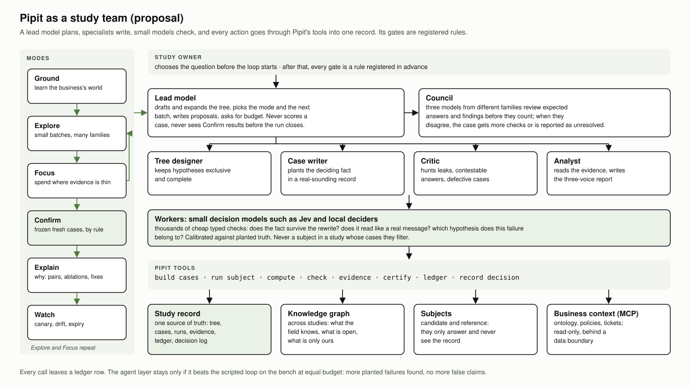

# Pipit as a study team

Proposal for 0.2, written 2026-11-01. It builds on 0.1 (`docs/plan.md`): the commands the team acts through and
the bench that judges it. Milestone M6. Each step becomes its own issue and pull request, one at a time, when it
starts.

## In plain words

Today a study runs as a script: write the cases, run the models, count. It works, but a person does all the
thinking between steps, and the whole case set is built before anything is measured.

The proposal is a study team. A larger model leads: it drafts the hypothesis tree, decides what to test next, and
writes the cases with specialist helpers. Small decision models such as Jev work as the team's checkers, running
thousands of cheap, typed checks on every case. Everything the team does goes through Pipit's own tools into one
shared study record, with a ledger row for every call. The gates are rules registered in advance, so no step waits
for a person.

The team builds and tests in small batches and moves between modes, so measuring starts on day one instead of
after the dataset is finished. It can plug into a business's own context, such as its policies, products, ticket
formats or knowledge graph, so the cases look like that business's world. And it improves its own instructions only
where a test with known answers shows the change helps.

## What stays the same, whatever the agents do

The agents serve the study; they do not replace its rules.

- **The objective comes first.** Every study still starts from a business question, which the study owner chooses
  before the loop starts, and a hypothesis tree registered before anything runs.
- **Every study still ends in the reliance dossier:** where the model breaks, how much it can handle alone at a
  stated silent-error rate, which settings change that, what it cost, when it expires, and what is still unknown.
- **The nuances stay in code.** Expected answers are planted and computed, not judged. A validator flag is settled
  by the planted truth, which a second, independent implementation checks; a flag they cannot settle gets more
  checks or is reported as unresolved. The certificate is an exact test, not a model's opinion. Results are told
  in three voices.
- **No agent can skip a gate.** Pre-registration, adjudication and Confirm follow rules registered in advance,
  which no agent can change; agents can only propose.

## The guard: the team has to earn its place

An agent layer is a method like any other. It stays only if it beats the scripted loop on the bench at the same
budget. The bench is M1's synthetic subjects, whose failures are planted, so the score needs no judge. The team
must find more of the planted failures, make no more false claims, and cost no more per finding. If it does not,
Pipit keeps the tools and drops the agents. Without this test it would be a generic agent wrapper, which the
programme's own operating rules weight at about 5% of the effort.

## The team

| Role | Who | Does | Never |
| --- | --- | --- | --- |
| Lead | a large model, named in a manifest | drafts and expands the tree, chooses the mode and the next batch, writes proposals, asks for budget | scores a case; sees Confirm results before the run closes; writes the record except through tools |
| Specialists | sub-agents of the lead, each with its own context | tree designer, case writer, critic, analyst | see each other's drafts unless the lead passes them on |
| Workers | small decision models: Jev, local deciders such as d3-mini | typed checks at volume: does the fact survive the rewrite, does it read like a real message, which hypothesis a failure belongs to, near-duplicates | filter the cases of a study in which they are also a subject |
| Council | three models from different families | review expected answers and findings before they count | decide alone: when they disagree, the case gets more checks or is reported as unresolved |
| Lab models | as today: paraphraser, validator | rewrite and check cases | judge themselves |
| Subjects | candidate and reference | answer | see the record or the tree |
| Study owner | a person | chooses the question before the loop starts, and makes the decisions listed at the end of this note | stands at a gate: pre-registration, flags, proposals and Confirm follow their registered rules |

The worker rule is new and it matters. A model that filters cases keeps the ones it reads well, so the case set
tilts in its favour. If Jev checked P1's cases, P1 could not also use Jev as its reference.

## Modes

The team does not build the whole dataset and then evaluate. It moves between modes, and each has its own rules.

| Mode | Goal | How cases are made and run | Ends when | Gate |
| --- | --- | --- | --- | --- |
| Ground | learn the business's world | read its policies, products, ticket samples and ontology through MCP | a one-page context brief exists | logged |
| Explore | find where failures might be | small batches across many families: write, check, run, update the tree, repeat | the explore budget is spent, or every hypothesis has a first signal | logged |
| Focus | measure the promising cells | spend budget where evidence is thin and stakes are high (M2's allocator) | the stopping rule (#25) says the evidence is sufficient | logged |
| Confirm | certify | fresh cases on a protected split, frozen before the run; agents see no results until it closes | the fixed size is reached | opened and closed by its registered rules |
| Explain | find out why | counterfactual pairs, ablations, composition rules, fix tests | a mechanism claim, or "unknown" | its registered rule: a cause is claimed only where an intervention changed the outcome |
| Watch | keep it true | canary re-runs on a schedule (#23) | a drift alarm, which reopens Confirm | logged |

Explore and Focus interleave building and measuring. Confirm is deliberately not adaptive: that is what keeps the
certificate honest after an adaptive search.

## One shared record

- **The study record is the only source of truth:** the pre-registration, the tree, family specs, cases with their
  hashes, runs, evidence, the ledger, and a decision log saying who decided what, when and why. Agents read and
  write it only through tools. An agent's chat history is never the record.
- **A knowledge graph across studies** holds models, studies, hypotheses, families, findings and sources, linked by
  supports, refutes, derived from and contradicts. A lead can ask "what do we already know about this model and
  arithmetic?" before proposing anything, which keeps what the field knows, what it lists as open, and what is only
  new to us apart. It starts as a findings registry with provenance and becomes a graph when the questions need it.
- Both are exposed to agents as tools, and as an MCP server so other agents, a business's own included, can query
  them.

## Tools and a business's context

- **Pipit tools**, typed and budgeted: build cases from a family spec, run a subject, compute, check, evidence,
  certify, ledger summary, propose, record a decision. Every call leaves a ledger row.
- **Compute:** sandboxed code for every planted number, such as doses, dates and money, so no model is ever asked
  to do the arithmetic that sets an expected answer.
- **A business's context through MCP:** its ontology or knowledge graph, policies, documents, ticket samples and
  product catalogue. Read-only by default.
- **A data boundary:** the manifest says which models may see which context. A business's data goes only to local
  models or to vendors it has approved, and everything sent is logged. Deep Agents' own documentation says the same
  in its terms: enforce boundaries in the tools, not by trusting the model.
- **Budget caps per role and mode,** held by the ledger. The lead may ask for more within the budget registered for
  the study; once that is spent, the work stops and the report says so.

## Any size of model, and scale

- **Every model is a manifest.** The lead, specialists, workers, council, lab models and subjects are all declared
  the same way: identifier, revision, placement, device, dtype, key name. A 0.6B local decider, a 4B LLM served by
  MLX on this laptop, a 27B model on vLLM or SGLang on a rented GPU and a frontier model behind an API differ only
  in their manifest and adapter. Roles stay fixed when models change.
- **Placement decides where it runs:** local when the measured footprint fits, a GPU machine when the reference path
  needs CUDA, an API otherwise. Nothing falls back silently.
- **Scale comes from cheap workers, caching and batches,** not from a bigger lead. Workers run in parallel through
  asynchronous sub-agents; every request is cached by its hash; the lead only plans. The ledger shows the cost of
  each role so the expensive one is visible.
- **Comparisons across sizes are paired:** the same cases, the same checks, the same certificate, so "does the 27B
  model earn its price over the 4B one for this job" is a measured answer with an interval.

## Self-improvement: an autoresearch loop with a frozen judge

Karpathy's autoresearch (March 2026) gives the shape. A person writes `program.md` with the goal and the rules. The
agent may edit one file. A fixed, short experiment scores each edit on one number the agent cannot touch. The edit
is kept if the number improves and discarded otherwise, every trial is a row in a log, and a small gain that adds a
lot of complexity is not worth keeping. Pipit uses the same shape to improve its own study process.

| autoresearch | Pipit |
| --- | --- |
| `program.md`, written by a person | the objective, the bench, the surface the agent may edit, the budget per trial, and the never-list |
| `train.py`, the only file the agent edits | the team's instructions, family templates, allocation settings, worker thresholds, proposed new checks |
| `prepare.py` and the validation score, never edited | the bench: synthetic subjects with planted failures, the executable checks and the certificate |
| a fixed five-minute run | a fixed budget per trial, in cases and dollars |
| keep if the validation loss improves | keep if planted failures found per dollar improve beyond noise across repeated trials, with no more false claims and case validity above a floor |
| `results.tsv`: keep, discard, crash | the ledger and the decision log |

What this adds over a free-form "self-improving agent": the judge is frozen and out of the agent's reach, every
change is a small, reversible, logged experiment, and improvement is measured, not claimed. The recursion is
bounded: the team can improve how it studies, never how it is scored.

Two guards that autoresearch does not need and Pipit does:

- **Overfitting to the bench.** A team tuned on the same synthetic subjects can learn their quirks. Kept changes are
  re-checked on bench subjects that tuning never sees, and on one real study, before they ship.
- **Validity.** "More failures found" is the easiest number to fake: write broken cases. Case validity is part of
  the score: code and critics measured on planted items check a sample of every kept change.

**The same loop improves the systems Pipit studies.** The loop that tunes the study team can tune a business's own
decision pipeline, such as its thresholds, its composition rules and its prompts, against a frozen planted-truth
bench and the certificate. The P3 pilot's composition test was one hand-run trial of that loop: combining the
danger answer with the route helped one model and not the other. This is the "improve AI systems" half of a
data-first workbench; training data comes later.

**Related work.** LangSmith turns human corrections of an LLM grader into few-shot examples that realign it, and
LangChain Labs (May 2026) works on continual learning for agents and on prompt optimisation across model families.
Pipit aligns its checkers the same way, but a checker never scores the bench: planted truth and code do. Other
self-improving systems, such as AlphaEvolve, the Darwin Gödel Machine, the AI Scientist and ADAS, all stand on an
automated evaluator. Pipit's contribution is an evaluator for evaluation itself, built on planted truth. Method
candidates for the edit step are reflective prompt evolution (GEPA, Agrawal et al., 2025) and DSPy's optimisers.

**Never:** tune on the study being measured; let a model judge its own output; touch a Confirm set; count failures
found without counting validity.

## Build or borrow

- **Borrow the runtime.** LangChain's Deep Agents offers what a long study needs: planning, sub-agents with their
  own context, a file store with pluggable backends, human approval on chosen tool calls (`interrupt_on`), memory
  files, sandboxes, and LangGraph underneath for persistence and for resuming a paused study. Tools from any MCP
  server come in through `tools`. Read on 2026-11-01 from its README and documentation overview.
- **Keep Pipit's meaning in Pipit.** The study record, modes, gates, ledger and checks stay in the core, which still
  imports no agent or model library. The agent layer is an optional extra at the edge, `pipit[agents]`, like the
  model adapters. If the runtime changes, studies and their records stay valid.
- **Alternatives behind the same tools:** the Claude Agent SDK, or plain LangGraph.

## What is known, what is open, what is ours

- **Known:** agents can audit models through multi-turn probing (Petri, Anthropic's auditing agents), generate
  evaluations from a behaviour description (Bloom), and steer tests by failures with a person in the loop
  (AdaTest). Prompts can be optimised against a metric (GEPA, DSPy).
- **Open:** whether an agent team finds real failures more cheaply than a fixed procedure without inventing
  defective cases, and how to keep claims valid when an agent chooses what to test next.
- **Ours:** measuring both on planted-truth subjects with a cost ledger, and the worker rule above.

None of these sources has been read in full for this project: autoresearch and the LangChain work were read through their documentation and secondary write-ups on 2026-11-01. Each is read before a claim relies on it.

## Plan: milestone M6, after 0.1.0, one step at a time

Question: does an agentic study team find planted failures with fewer cases and dollars than the scripted loop,
without more false claims? If not, Pipit keeps the tools and drops the agents.

1. The study record and decision log as data, on top of 0.1's study files and `report.json`.
2. Pipit tools: the 0.1 commands as typed, budgeted tools.
3. Modes as a state machine with gates, scripted first, with no model involved.
4. Agent layer v0 on the chosen runtime: lead, case writer, critic and workers, with gates as registered rules, run
   on the P3 screen's Explore mode, and kept or killed on the bench.
5. A business's context through MCP, with the data boundary; a synthetic energy supplier's policy pack as the demo.
6. The knowledge graph across studies, starting as a findings registry.
7. The autoresearch loop with a frozen judge, only after step 4 passes: first on the team's own instructions, then on a business pipeline's thresholds and composition rules.

Each step waits for the one before it to merge. Steps 4 and 7 need M1's bench (#8); the case writer needs the
family spec (#22); Focus needs the stopping rule (#25); Watch needs the canary (#23).

## Decisions for the study owner

1. Which large model leads, and the budget per study.
2. Deep Agents, the Claude Agent SDK, or our own LangGraph.
3. Whether a business's context may ever leave the machine, or only reach local models.
4. Whether the team stays in 0.2, as proposed, or is pulled into 0.1 (`docs/plan.md`).
