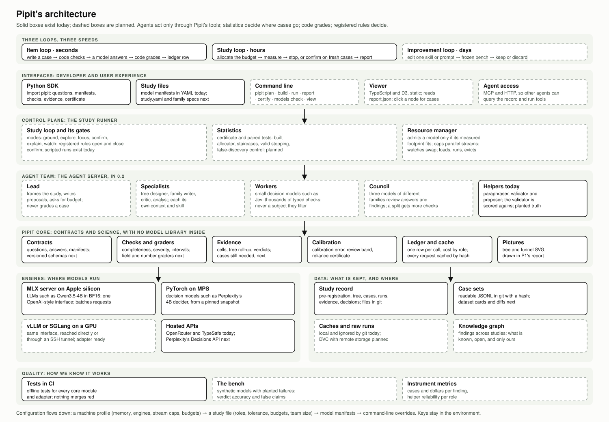

# Architecture

Written 2026-11-01. What Pipit is made of, how its parts talk, how you control it, and how it stays inside a
laptop's memory. Solid boxes in the picture exist today; dashed boxes are planned, each tied to a step of
`docs/plan.md`.

## In plain words

At the centre is a Python library, the core: the contracts every model and study must follow, the checks and
graders, the evidence and the certificate, the ledger and the cache. It imports no model library. Below it sit the
engines that run models, each reached through a small adapter. Beside it sits the data: the study record, the case
sets, the caches. Above it sits the study runner, which decides what happens next, and in 0.2 an agent team that
writes and reviews, acting only through Pipit's tools. At the top are the ways people and other agents use it: the
Python library, study files, a command line, a viewer, and access over MCP.



## The components

| Layer | Component | Today | Next |
| --- | --- | --- | --- |
| Interfaces | Python SDK | the core's functions | stable entry points with the command line |
| | Study files | model manifests | study files and family specs (plan steps 6 and 7) |
| | Command line | per-study scripts | `pipit plan`, `build`, `run`, `report`, `certify`, `models check`, `view` |
| | Viewer | report pages and SVG pictures | `report.json` and a static TypeScript and D3 viewer (step 5) |
| | Agent access | none | MCP and HTTP over the record and the tools (0.2) |
| Control plane | Study loop and gates | scripted runs per study | modes and gates as a state machine (step 4) |
| | Statistics | intervals, paired tests, reliance certificate | allocation, staircases, valid early stopping, false-discovery control (step 4) |
| | Resource manager | rules followed by hand | admission by measured footprint, stream caps, swap watch (below) |
| Agent team | Lead, specialists, workers, council | helper models: paraphraser, validator, proposer | the team in 0.2, carrying `docs/methodology.md` |
| Core | Contracts, checks, evidence, calibration, ledger, cache, pictures | built and tested | versioned schemas; field and number graders; cases still needed per node |
| Engines | MLX, PyTorch on MPS, hosted APIs | built | vLLM and SGLang on a GPU when a host is available |
| Data | Study record, case sets in git | built | dataset cards and diffs; DVC for caches and raw runs; a knowledge graph |
| Quality | Tests in CI | built | the bench (step 3) and instrument metrics |

## Three loops, three speeds

- **The item loop, in seconds:** write a case, check it by code, let a model answer, grade the answer by code, write
  a ledger row. Everything here is code except the writing and the answering.
- **The study loop, in hours:** allocate the budget, measure, then stop or confirm on fresh cases, then report.
  Statistics decide where the next cases go and when to stop; a person opens and closes confirmation.
- **The improvement loop, in days:** change one skill or prompt, run the frozen bench, keep the change or discard it.
  The bench's judge is planted truth, which no agent can edit.

## How you control it

Configuration flows down, and each level can override the one above it.

1. **A machine profile** says what this computer can do: its memory, the engines it has, how many parallel streams
   each model may run, and default budgets.
2. **A study file** says what this study needs: the question, the tolerance, which model plays which role, the team's
   size in 0.2, and the budget in dollars, hours and cases.
3. **Model manifests** say how to reach each model.
4. **The command line** overrides any of these for one run.

```yaml
# pipit.yaml: this machine (planned)
profile: laptop
memory_gb: 24
streams:                       # parallel requests per model and mode, from measured footprints
  qwen35_4b_thinking: 3
  qwen35_4b_instruct: 6
budget: {usd_per_study: 2.0, hours_per_study: 6}
```

```yaml
# studies/p3_support_crisis/study.yaml (planned)
question: Can a contact centre let the model sort the queue alone?
tolerance: 0.02                # missed crises per message the business can accept
candidates: [models/pplx_flash.yaml]
reference: models/jev.yaml
helpers: {writer: models/writer.yaml, critic: models/critic.yaml}
team: {lead: models/lead.yaml, workers: 4, council: 3}   # 0.2
budget: {usd: 1.0, hours: 3, cases: 500}
```

Before anything runs, `pipit plan` reads past ledger rows and prints the expected cases, calls, tokens, dollars and
hours, and refuses to start a study that does not fit its budget. During the run, the ledger stops any role that
reaches its cap. Keys stay in the environment.

## Memory on a laptop

Measured on this Mac, an M4 Pro with 24 GB:

| What runs | Memory |
| --- | --- |
| Perplexity's 4B decider in BF16 on MPS | about 9.5 GB |
| Qwen3.5-4B in BF16 on MLX, serving short answers | about 9.3 GB |
| the same, ten short reasoning streams | about 13 GB |
| the same, six to twelve long reasoning streams (2,500 to 6,200 tokens each) | 16 to 17 GB, then heavy swapping |

The rules the resource manager will enforce, followed by hand today:

- **One large model resident at a time,** loaded for a run and released after it.
- **Stream caps per model and mode,** set from measured footprints. Reasoning memory grows with the length of the
  reasoning, so a thinking model gets fewer streams than the same model answering in one token. On this Mac:
  three for Qwen3.5-4B thinking.
- **Watch memory pressure and back off before swap.** Swapping did not crash anything; it made the run many times
  slower.
- **Every answer is cached as it arrives,** so stopping a run loses only the answers in flight.

## Across machines, later

Engines can live anywhere behind the same interface: a GPU machine reached through an SSH tunnel, or a hosted API.
The study runner stays where the record is. The record and the case sets move through git; the heavy parts move
through DVC. Placement chooses an engine by measured footprint and cost, and records the choice, so a result says
where it ran.
