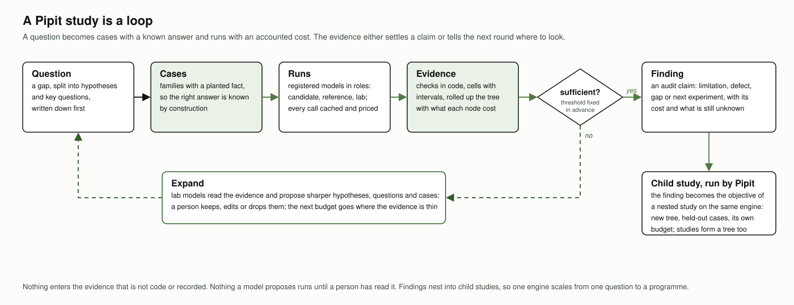
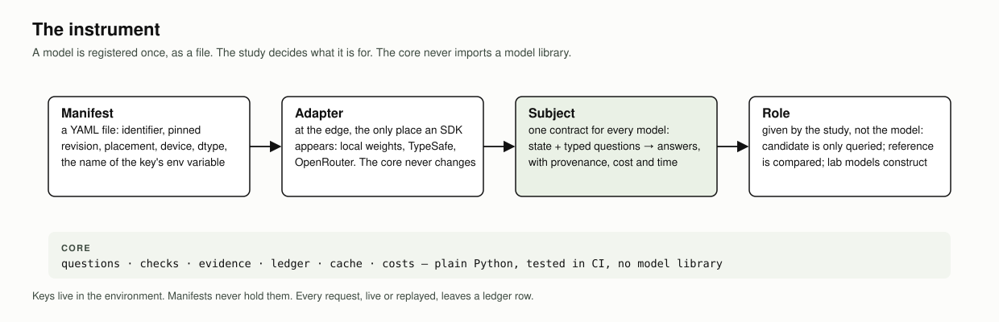

# Pipit design

## In plain words

Pipit helps you find out, with evidence and at a known cost, what a model gets wrong. You write down the question
and what a right answer looks like before anything runs. You build test cases where the right answer is planted,
so no judge is needed to score them. The model under test answers; every call is saved and priced. The result is
a count of wrong answers with a range for how sure you can be, sorted by how bad each mistake is, and a plain
statement of what is still unknown. Strong evidence becomes a finding and opens a deeper study. Weak evidence
sends helper models to propose what to try next, and a person decides. The rest of this note is the detail.

Pipit turns a question about a model into a budgeted experiment and an accounted claim. This note describes the
instrument as built for the first real study (P1, `studies/p1_clinical/`), the loop it runs, the references it
draws on, and where it differs from them. It is short on purpose; the study is the source.

## Scope now

Pipit is the engine for empirical study of models, LLMs and agent systems: measurement and audit of nuanced
behaviour first, with evidence that says where it is sufficient and where it is not. Each new use case (clinical
safety, alignment and trust properties, agent reliability) is a study on the same engine: a hypothesis tree,
registered models in their roles, a planted-truth case set, a continuous pipeline that runs, checks, rolls up and
proposes, and sample-efficient allocation measured against uniform sampling and against established benchmarks as
anchors. Data for improvement (post-training, in-context demonstrations) is a later phase and is produced only
from a limitation confirmed on a protected split.

## The loop

A question is split into hypotheses and key questions before anything runs. Cases carry a planted fact, so the
right answer is known by construction and scoring needs no judge. Registered models run in the roles the study
gives them, every call cached and priced. Evidence is computed in code, rolled up the hypothesis tree with what
each node cost, and judged against a threshold set in advance. Sufficient evidence becomes an audit finding and
opens a deeper study on a protected split; insufficient evidence sends the lab models to propose sharper
hypotheses, questions and cases, which a person keeps, edits or drops before the next round.

**Studies nest.** A finding does not end a study; it becomes the objective of a child study that Pipit runs on
the same engine: the parent's manifests, cache and ledger, a new tree under the finding, held-out cases on a
protected split, its own budget. Studies therefore form a tree as hypotheses do, and the allocation question of
M2, where to spend the next budget, applies across child studies as it applies across hypotheses. That is how
one engine scales from one question to a programme without a new pipeline per use case.

## The loop, step by step, and where it lives

| Step | What happens | Code |
| --- | --- | --- |
| 1 Objective | a gap is named and the expected behaviour written down before any run | `studies/<study>/preregistration.md` |
| 2 Hypothesis tree | exclusive, exhaustive hypotheses by mechanism; key questions under each | `hypotheses.yaml`, `pipit.evidence.rollup` |
| 3 Case families | scenarios with a critical fact planted in three conditions and an expected answer each | `seeds.py` |
| 4 Construction | lab models paraphrase and validate; executable checks exclude broken generations; everything cached and priced | `build_cases.py`, `pipit.adapters.openrouter`, `pipit.checks`, `pipit.cache`, `pipit.ledger` |
| 5 Case set | immutable once referenced, content-hashed, reproducible from the cache | `cases.jsonl`, `case_set.json` |
| 6 Registration | a model is a YAML manifest resolved through an edge adapter into a subject; role comes from the study; an LLM behind any OpenAI-style endpoint (MLX, vLLM, SGLang) answers typed questions through `pipit.adapters.openai_compat` | `models/*.yaml`, `pipit.manifest`, `pipit.adapters.*` |
| 7 Runs | each subject answers the typed questions of every eligible case; answers merge, reruns cover only new cases | `run.py`, `pipit.questions` |
| 8 Checks | expected option, severity (unsafe, over-cautious, false certainty), Wilson intervals | `pipit.checks` |
| 9 Evidence | cells per (family, condition), verdicts, bottom-up roll-up with budget, reading versus deciding, wording invariance, cases-to-evidence, paired tests between subjects, and the reliance certificate: how much the model can handle alone at a stated silent-error rate | `pipit.evidence`, `pipit.calibration`, `analyse.py` |
| 10 Adjudication | a person reads every validator flag; primary and adjudicated analyses are both reported | `adjudication.yaml` |
| 11 Report | one document with sets, tree, cells, agreement, ledger | `report.md` |
| 12 Proposals | a lab model proposes sharper questions, families and predictions; a person decides what enters round two | `propose.py`, `proposals.md` |

## The instrument

## What P1 showed about the instrument

- The lab-model validator flagged 31 of 120 cases; 25 were sound. It could not do mg/kg arithmetic or judge an
  interaction, it followed the allergy field and missed a conflicting history in all four conflict cases, and it
  twice called a twice-stated anaphylaxis false. The planted truth exposed this; a judge-scored pipeline would have
  absorbed it as model error.
- Executable checks caught six broken paraphrases (truncated or corrupted generations from a reasoning model
  across many providers), two of which the validator had passed.
- Both deciders failed the same way on weight-based doses: near chance on a double dose, "withhold" on a correct
  one. Their confidence carried no information about dose safety. That is the finding worth the next round.
- Cost of the whole study: about 0.015 USD of lab-model calls plus 60k Jev tokens; the candidate ran locally at
  2 s per case with a 9.5 GB peak.

## References and where Pipit differs

`docs/landscape.md` compares Pipit with the field in depth, from six research passes on 2026-11-01; this table is
the short version. The right-hand column states what Pipit does differently; none of it is a claim of novelty for a
single piece.

| Reference | Fundamental | Pipit's difference in P1 |
| --- | --- | --- |
| CheckList (Ribeiro et al., ACL 2020) | behavioural tests: minimum functionality, invariance, directional | the same three test kinds appear as conditions and wordings, with planted truth so no annotation step is needed |
| AdaTest (Ribeiro and Lundberg, ACL 2022) | model-generated tests, human in the loop | proposals are generated from evidence and gated by a person; the human reads every validator flag |
| WEAVER (Findings of EMNLP 2023) | define the investigation space first | the hypothesis tree is written before cases exist and rolls evidence up |
| tinyBenchmarks (Polo et al., ICML 2024) | estimate a benchmark from few, well-chosen items | it needs hundreds of earlier models answering the same items; Pipit has none yet, so adaptive measurement works on difficulty set by construction, tested on the bench (M2) |
| SubLIME (ACL 2025) | choose subsets by the decision to be made | cells and verdicts are built around one decision: is there a limitation here |
| FAC2E (EMNLP 2024) | multidimensional capability profiles | the tree gives a profile by mechanism, not one score |
| NeMo Data Designer, Distilabel | declarative, inspectable construction | construction is code plus manifests, cached, content-hashed, with lineage per case; Data Designer (active, Apache-2.0) is the candidate generator for family specs (#22); Distilabel is in maintenance |
| Inspect AI (UK AISI, Meridian Labs) | composable datasets, solvers, scorers, logs, viewer | the field's default runner: METR moved to it and HELM points to it; Pipit's cases and statistics should run on it or read its logs (`docs/landscape.md`) |
| METR, Artificial Analysis | task quality, configurations, cost separated from capability | manifests fix configuration; the ledger separates cost by role |
| Bloom (Anthropic, 2025; now petri_bloom at Meridian Labs) | behaviour → scenarios → interactions → judge | planted truth replaces the judge for scoring; the only lab-model judgment is calibrated against the plant |
| Petri, auditing agents (Anthropic, 2025; now inspect_petri) | adaptive multi-turn auditing, hypotheses with counterevidence | single-turn typed decisions so far; the tree records support and insufficiency, not yet counterevidence |
| A3 (Anthropic, 2026) | diagnosis → targeted data → fine-tune → evaluate | out of scope until a limitation is confirmed on a protected split |

## Open problems, in order

1. Confirm on a protected split: new scenarios for the dose family, split by scenario family (M3's done-when).
2. Adaptive allocation over the tree against uniform at equal budget (M2).
3. The instrument proofs on a synthetic subject with planted limitations, defects and holes (M1), run on this code.
4. Multiple acceptable answers per cell, so a cautious choice on a conflicting record is not scored as certainty.
5. A price list for subjects whose responses do not price themselves.
